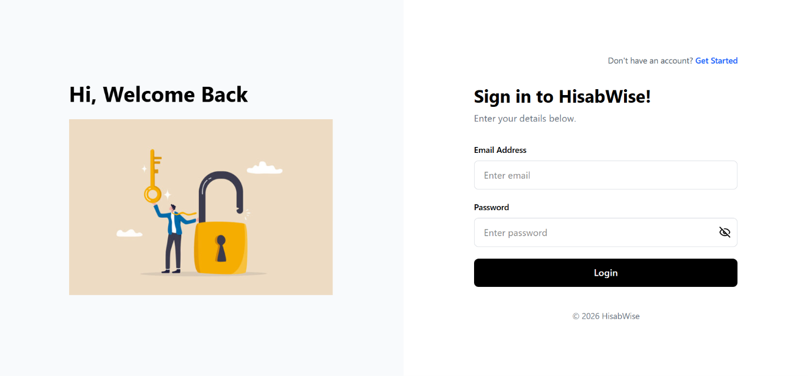
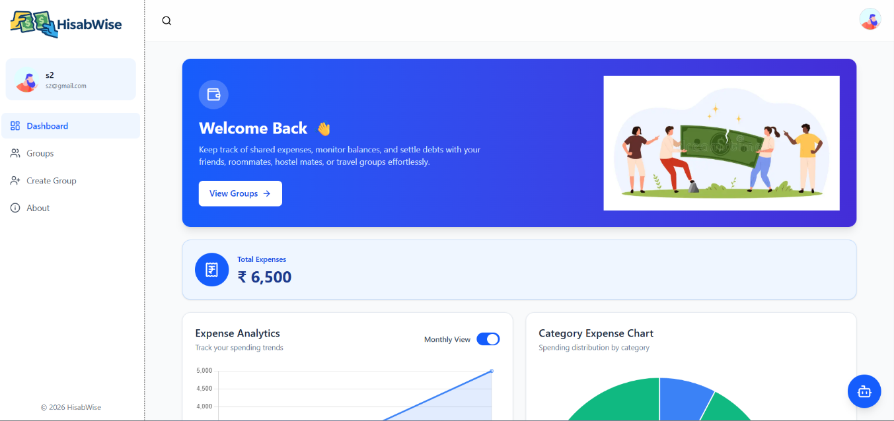
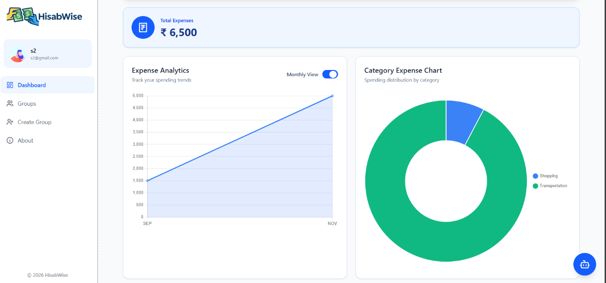
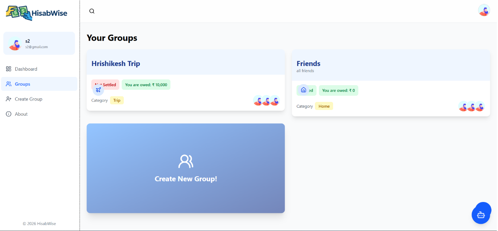
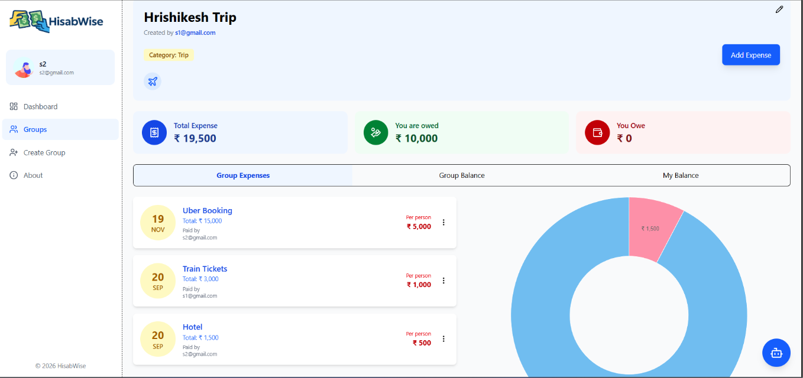
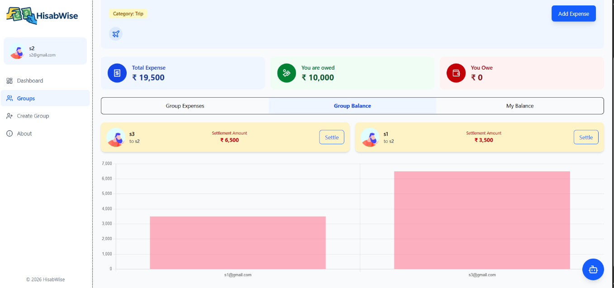
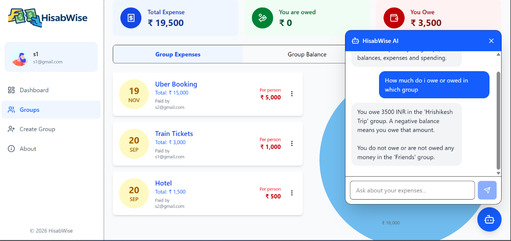

<div align="center">


# HisabWise

### Shared expenses, simplified.

An all-in-one expense-sharing application for tracking group spending, understanding balances, and settling up with friends, roommates, or colleagues.

[](https://hisabwise.vercel.app)
[](https://react.dev/)
[](https://expressjs.com/)
[](https://www.mongodb.com/)

[Explore the App](https://hisabwise.vercel.app) · [Report a Bug](https://github.com/sumitp0808/HisabWise/issues) · [Request a Feature](https://github.com/sumitp0808/HisabWise/issues)

</div>

---

## About the Project

**HisabWise** makes shared finances easy to manage. Create groups for trips, houses, events, or teams, add expenses, split costs among selected members, and see exactly who owes whom.

The platform combines an intuitive React interface with a RESTful Express API, MongoDB persistence, JWT authentication, interactive Chart.js analytics, and Google Gemini-powered assistance.

> The live frontend is deployed on Vercel and the backend is hosted on Render.

---

## Screenshots

### Sign up or log in



### Dashboard overview



### Expense and category analytics



### Manage groups

<p align="center">
  
  
</p>

### Balance and settlement view



### AI assistant



---

## Key Features

- **Secure authentication** - Account registration, login, password updates, profile editing, and JWT-protected routes.
- **Flexible groups** - Create and edit groups with custom names, descriptions, categories, currencies, owners, and members.
- **Expense management** - Add, view, edit, and delete expenses with categories, dates, descriptions, owners, and participating members.
- **Automatic split tracking** - Expense totals are divided among participating members and reflected in the group balance.
- **Settlement workflow** - Review current balances and record settlements between group members.
- **Visual analytics** - Explore spending through dashboard summaries and category, monthly, daily, and group charts.
- **AI assistant** - Ask an expense assistant for help through Gemini-powered chat.
- **Responsive interface** - Use the application across desktop, tablet, and mobile screens.
- **Notification feedback** - React Hot Toast provides clear success and error messages.
- **Profile management** - Update account details and delete a user account.

---

## Tech Stack

### Frontend

| Technology | Purpose |
|---|---|
| React 19 | Component-based user interface |
| Vite 8 | Fast development server and optimized builds |
| React Router 7 | Client-side routing |
| Tailwind CSS 4 | Utility-first styling |
| Chart.js | Spending and balance visualizations |
| Axios | API communication and auth headers |
| Formik + Yup | Form state management and validation |
| React Hot Toast | In-app notifications |
| Lucide React + React Icons | Interface icons |

### Backend

| Technology | Purpose |
|---|---|
| Node.js | JavaScript runtime |
| Express 4 | REST API and middleware |
| MongoDB + Mongoose | Persistent application data |
| JSON Web Tokens | Stateless API authentication |
| bcryptjs | Password hashing |
| Google Gen AI SDK | Gemini AI assistant integration |
| Morgan + Winston | HTTP logging and application logs |
| dotenv + CORS | Environment configuration and cross-origin requests |

---

## Architecture

```text
Browser
   |
   | HTTPS / JSON
   v
React + Vite Frontend
   |
   | Axios + Bearer Token
   v
Express REST API
   |
   +--> JWT Authentication
   +--> Group & Expense Controllers
   +--> Gemini AI Controller
   |
   v
MongoDB
```

### Main API areas

| Base route | Responsibility |
|---|---|
| `/api/users` | Registration, login, profile, password, and account operations |
| `/api/group` | Group CRUD, members, balances, and settlements |
| `/api/expense` | Expense CRUD, summaries, and chart data |
| `/api/ai` | Gemini-powered expense chat |

Protected group, expense, and AI routes require a JWT access token in the `Authorization` header:

```http
Authorization: token <access-token>
```

---

## Project Structure

```text
HisabWise/
├── backend/
│   ├── ai/                 # Gemini client integration
│   ├── controllers/        # API business logic
│   ├── middleware/         # JWT authentication
│   ├── models/             # Mongoose models
│   ├── routes/             # Express route definitions
│   ├── utils/              # Validation and split calculations
│   ├── server.js           # Server entry point
│   └── package.json
├── frontend/
│   ├── public/static/      # Public logos and illustrations
│   ├── src/
│   │   ├── api/            # Axios client and API methods
│   │   ├── components/     # Feature and page components
│   │   ├── layouts/        # Dashboard shell and navigation
│   │   ├── config.json     # Frontend route configuration
│   │   ├── Router.jsx      # Application routes
│   │   └── main.jsx        # Frontend entry point
│   └── package.json
├── docs/
│   └── images/             # README screenshots
└── README.md
```

---

## Getting Started

### Prerequisites

- Node.js 20 or newer
- npm
- MongoDB local instance or MongoDB Atlas
- A Google Gemini API key for the AI assistant

### 1. Clone the repository

```bash
git clone https://github.com/sumitp0808/HisabWise.git
cd HisabWise
```

### 2. Configure the backend

Create `backend/.env`:

```env
PORT=3000
NODE_ENV=development
MONGODB_URI=your_mongodb_connection_string
ACCESS_TOKEN_SECRET=your_long_random_jwt_secret
GEMINI_API_KEY=your_gemini_api_key
```

Generate a strong JWT secret:

```bash
node -e "console.log(require('crypto').randomBytes(64).toString('hex'))"
```

For `NODE_ENV=production`, use platform environment variables and never commit `.env` files or secrets.

### 3. Install dependencies and run the backend

```bash
cd backend
npm install
npm run dev
```

The API will start on `http://localhost:3000` by default.

### 4. Install dependencies and run the frontend

Open a second terminal:

```bash
cd frontend
npm install
npm run dev
```

The Vite app normally starts at `http://localhost:5173`.

By default, the frontend API client points to the deployed backend. For local development, update `frontend/src/api/index.js` to use:

```js
const API = axios.create({ baseURL: "http://localhost:3000" });
```

---

## Available Scripts

### Backend

| Command | Description |
|---|---|
| `npm run dev` | Run the API with Nodemon |
| `npm start` | Run the API with Node.js |

Run these commands from `backend/`.

### Frontend

| Command | Description |
|---|---|
| `npm run dev` | Start the Vite development server |
| `npm run build` | Create a production build |
| `npm run preview` | Preview the production build locally |
| `npm run lint` | Run ESLint |

Run these commands from `frontend/`.

---

## Environment Variables

### Backend

| Variable | Required | Description |
|---|---:|---|
| `MONGODB_URI` | Yes | MongoDB connection string |
| `ACCESS_TOKEN_SECRET` | Yes | Secret used to sign and verify JWT access tokens |
| `GEMINI_API_KEY` | For AI chat | Google Gemini API key |
| `PORT` | No | API port; defaults to `3000` |
| `NODE_ENV` | No | Runtime environment |

---

## Core Data Models

### User

Stores account identity, authentication details, profile information, and user-level preferences.

### Group

Stores group name, description, currency, owner, category, members, total, and member split values.

### Expense

Stores expense identity, amount, owner, participating members, category, date, currency, type, and per-member share.

### Settlement

Tracks settlements recorded between users for a group.

---

## Deployment

### Frontend

The frontend is compatible with Vercel and other static hosting providers.

```bash
cd frontend
npm run build
```

Deploy the generated `frontend/dist` directory. Configure your host to serve `index.html` for client-side routes.

### Backend

Deploy `backend/` to Render, Railway, or another Node.js hosting service. Configure:

- `MONGODB_URI`
- `ACCESS_TOKEN_SECRET`
- `GEMINI_API_KEY`
- `PORT` if required by the hosting provider

Update the Express CORS allowlist in `backend/server.js` if you use a custom frontend domain.

---

## Roadmap

- [ ] Environment-based frontend API configuration
- [ ] Automated frontend and backend tests
- [ ] Equal, exact, and percentage-based split modes
- [ ] Receipt image uploads
- [ ] Recurring expenses
- [ ] Export balances and expenses
- [ ] Improved notifications and activity history
- [ ] Internationalization

---

## Contributing

Contributions are welcome.

1. Fork the repository.
2. Create a feature branch:

   ```bash
   git checkout -b feature/your-feature-name
   ```

3. Commit the change:

   ```bash
   git commit -m "Add your feature"
   ```

4. Push the branch:

   ```bash
   git push origin feature/your-feature-name
   ```

5. Open a pull request with a clear summary and screenshots for UI changes.

Please keep changes focused, avoid committing secrets, and run frontend lint/build checks before submitting.

---

## Support

If you encounter a problem or have an improvement in mind:

- Open an issue on [GitHub Issues](https://github.com/sumitp0808/HisabWise/issues)
- Include reproduction steps, expected behavior, actual behavior, and screenshots where relevant

---

## Acknowledgements

- [React](https://react.dev/)
- [Vite](https://vite.dev/)
- [Express](https://expressjs.com/)
- [MongoDB](https://www.mongodb.com/)
- [Chart.js](https://www.chartjs.org/)
- [Google Gemini](https://ai.google.dev/)

---

<div align="center">

Built for clearer conversations and fairer finances.

If HisabWise helps you, consider giving the repository a star!

[](https://github.com/sumitp0808/HisabWise/stargazers)

</div>